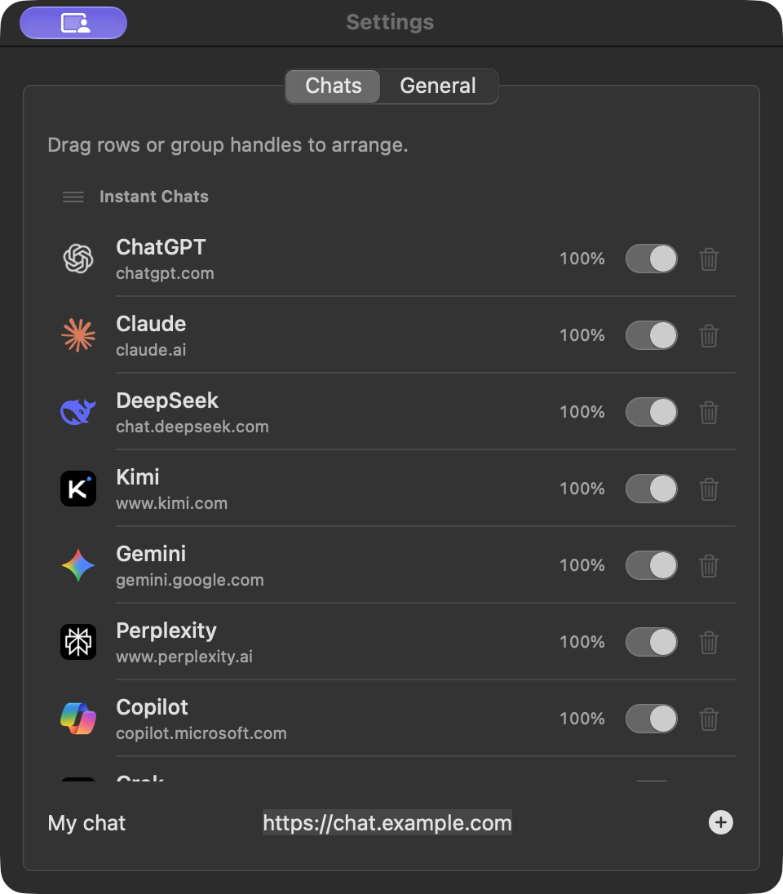

  
  <h1>Quick Chat Omni</h1>
  
<strong>Your chat websites. One small floating window.</strong>

  
ChatGPT · Claude · DeepSeek · Kimi · Gemini · Perplexity · Copilot · Grok · Your own

  

    
    
    
    
  

  
<a href="https://github.com/elvinzhao10/QuickChat-Omni/releases/latest"><strong>Download for Mac →</strong></a>

Quick Chat Omni brings the chat websites you already use into a small, movable macOS panel. Pick a logo, sign in on the website, and chat. No API keys or separate AI subscription required by the app; each website's own account and plan still apply.

### A little window that stays out of your way

- **Switch by logo.** Hover for names, or use **⌘1–9**. Instant chats sit on the left and pinned conversations on the right, separated by a thin line. Swipe or use the mouse wheel to move along the strip; the scrollbar stays hidden.
- **Make it yours.** Open Settings directly to add a website, hide or remove tabs, and drag them into your preferred order. You can drag the logos in the popup too.
- **Keep quick chats quick.** Instant tabs preserve their live page for 10 minutes by default, then start fresh. Choose immediate release or 1, 5, 10 or 30 minutes in Settings.
- **Keep a conversation.** Pin a chat to remember its URL after the live page expires or the app quits. Pins remember links, not unsent drafts.
- **Instant and pinned stay separate.** Each website has one instant slot. Pin a conversation to move it to the pinned side, then use the website’s instant slot for another quick chat. Unpin closes the saved tab and leaves the instant chat untouched. Hover shows only the topic. All tabs of a service share its sign-in.
- **Move freely.** Drag empty space at the top, resize from the corner, or double-click the header to expand and restore.
- **Continue in your browser.** The arrow button opens the current page in your default browser. Browser sign-in is separate.
- **Bring your files.** Use a website's upload button, paste an image, or drop a screenshot/file into its upload area when that website supports it.

 

**Settings.** Open the sliders button or choose **Settings…** from the menu bar. Use **Chats** to manage websites, pinned conversations, and their order. Use **General** to set page retention, configure shortcuts, or choose English, Simplified Chinese, or System Default. Websites can give priority to their own saved language. **Switch Chat** in the menu bar lists both instant and pinned chats.

### Install

1. Download the **DMG** from [Releases](https://github.com/elvinzhao10/QuickChat-Omni/releases/latest).
2. Open it and drag **Quick Chat Omni** into **Applications**.
3. Open the app and choose a website. Optionally turn on **Enable Global Shortcut** in **Settings → General** for **⌥Space** access.

The ZIP contains the same ready-built app if you prefer to unzip it. Both packages support Apple silicon and Intel Macs running macOS 14 or later.

The community build uses an ad-hoc signature. Apple notarization is unavailable for this build. If macOS blocks the first launch, confirm you downloaded it from this repository’s release page, then go to **System Settings → Privacy & Security → Open Anyway**. Confirm the prompt and open the app. [Apple’s first-launch guide](https://support.apple.com/en-us/102445)

### Small by design

Native Swift, AppKit and WebKit. No Electron runtime, icon-service requests, analytics, or background polling. At most three inactive pages are retained; older pages are released. Choose **Release Immediately** for the lowest retained memory use. Provider websites still consume their own resources, and macOS can reclaim pages under pressure.

Sign in directly on each website. Omni does not import your browser's cookies or collect passwords. Removing a website or tab only removes it from the list; your account and sign-in data are kept. Use **Settings → General → Privacy → Clear All Website Sign-ins…** to remove Omni’s local website data before uninstalling. Turning a website off preserves its login. Dragging the app to Trash leaves its website data on the Mac. Some providers restrict embedded sign-ins or uploads; use **Continue in Browser** if a particular flow is unsupported.

Build and verification

With Apple's command-line tools installed, run `make app`. The result is `build/Quick Chat Omni.app`.

Run `QUICKCHAT_SELFTEST=pages swift run QuickChat` for provider and cache checks, and `QUICKCHAT_SELFTEST=keymap swift run QuickChat` for shortcut regression checks. [Release audit](docs/RELEASE-AUDIT.md) records what was verified and the remaining limits.

Based on [shuaibird/Quick-Chat](https://github.com/shuaibird/Quick-Chat), with its MIT license and attribution preserved. Provider names and logos belong to their owners; no affiliation is implied.

See the [project TODO](TODO.md) for planned improvements.
