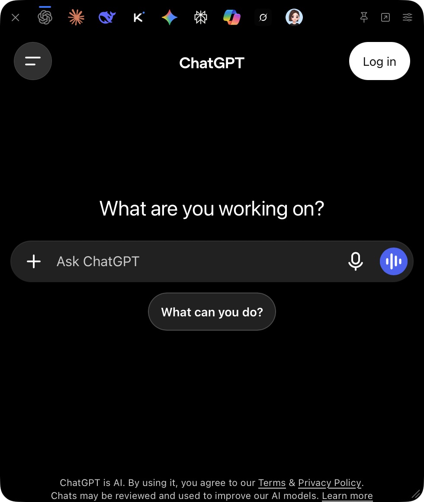
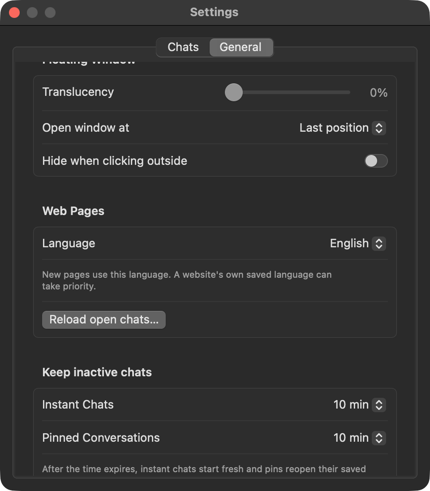

  
  <h1>FloatChat</h1>
  
<strong>Your chat websites in one floating Mac window.</strong>

  
<a href="https://github.com/elvinzhao10/FloatChat/releases/latest"><strong>Download for Mac</strong></a> · <a href="README.zh-CN.md">简体中文</a> · <a href="CHANGELOG.md">What’s new</a>

  
macOS 14+ · Apple silicon and Intel

  
FloatChat packs the chat websites you already use into a small, native macOS window. It uses Swift, AppKit, and the WebKit browser engine built into macOS. Pages are released when they’re idle, and there’s no separate browser runtime to ship.

  
Sign in directly on each website. WebKit keeps FloatChat’s sessions locally, separately from your default browser. FloatChat needs no account or API key of its own. Keep it alongside your other Mac apps, or open the current page in your default browser anytime.

  

  
        

  
Nine built-in providers, including Doubao (豆包), plus any HTTPS chat website you add.

## Get started

1. Download the **DMG**, open it, and drag **FloatChat** into **Applications**. The ZIP contains the same app.
2. Open FloatChat from **Applications**. Use its menu bar icon to reopen the window, or enable the global shortcut in **Settings → General** for **⌥Space** access.
3. Pick a provider icon and sign in on its website with your existing account. FloatChat works without API keys.

If macOS blocks the first launch

The community build uses ad-hoc signing and is distributed without Apple notarization. After trying to open it, verify the download came from the official release page, then choose **System Settings → Privacy & Security → Open Anyway**. [Apple’s first-launch guide](https://support.apple.com/en-us/102445)

## Use the floating window

| To… | Do this |
| --- | --- |
| Switch chats | Click a provider icon or press **⌘1–9**. Scroll the icon strip to reach more tabs. |
| Keep a conversation | Click the pin to save its link. Instant chats and pins share the same strip, separated by a thin line. Hover a pin for its topic. Unpinning closes the saved tab. |
| Adjust page size | Press **⌘+**, **⌘−**, or **⌘0** to reset. Use the percentage next to any chat in **Settings → Chats** for a slider. Each pinned chat can have its own zoom. |
| Move or resize | Drag the top edge to move, drag the corner to resize, or double-click the header to expand and restore. |
| Continue in your browser | Click the arrow to open the current page in your default browser. Use it when a provider requires a browser for sign-in or uploads. |
| Attach or download a file | Use the site’s upload button, paste, or drag a file in where supported. Completed downloads go to Downloads. Click **Show in Finder** to reveal one. |

## Add your own chat platform

1. Click the sliders icon to open **Settings → Chats**.
2. Enter a name and the platform’s HTTPS address, such as `https://chat.example.com`, then click **＋**.
3. Click the new icon in the floating window and sign in on the website.

Settings can stay open beside the floating window. In **Chats**, drag to reorder, hide sites with their switches, click the pencil to change a custom site’s name or address, or rename a pin. Click a custom site’s icon to choose a local image, restore the site’s icon, or refresh it. Right-click a tab to check its hostname or change its zoom. In **General → Floating Window**, choose the last or default position, hide the window on outside clicks, or adjust **Translucency** with a slider. Text and controls stay opaque. macOS 26 and later use Liquid Glass.

## Page retention and sign-ins

FloatChat keeps live pages while they are inactive. Under **Settings → General → Keep inactive chats**, choose a duration for instant chats and another for pins. The timer starts when you leave a chat or hide the window. After expiry, an instant chat reopens at its starting page and a pin reopens its saved conversation. Sign-ins are kept. Unsaved drafts can be lost when WebKit releases a page.

FloatChat and your default browser maintain separate sign-in sessions. Hiding or removing a website keeps its local login. Custom icons are fetched directly from the website over HTTPS in a separate session without chat cookies.

Clear website data or uninstall

Before uninstalling, choose **Settings → General → Privacy → Clear All Website Sign-ins…** and wait for it to finish. This clears local website storage in FloatChat. If you’ve already moved FloatChat to Trash, reinstall it from the official release page, run the clear action, then quit and remove it again.

For manual cleanup, quit FloatChat. In Finder, press **⇧⌘G** and check `~/Library/WebKit`, `~/Library/HTTPStorages`, and `~/Library/Caches`. Move only the folder named `dev.quickchat.omni` to Trash in each location if present. Storage locations vary with macOS version. The in-app reset is the reliable way to clear every FloatChat sign-in.

## Project

[Release history](https://github.com/elvinzhao10/FloatChat/releases) · [Changelog](CHANGELOG.md) · [Security](SECURITY.md) · [Release checks](docs/RELEASE-AUDIT.md) · [MIT license](LICENSE)

Build from source

With Apple’s command-line tools installed, run `make app`. The bundle is built at `build/FloatChat.app`.

Based on [shuaibird/Quick-Chat](https://github.com/shuaibird/Quick-Chat). Provider names and logos belong to their respective owners.
