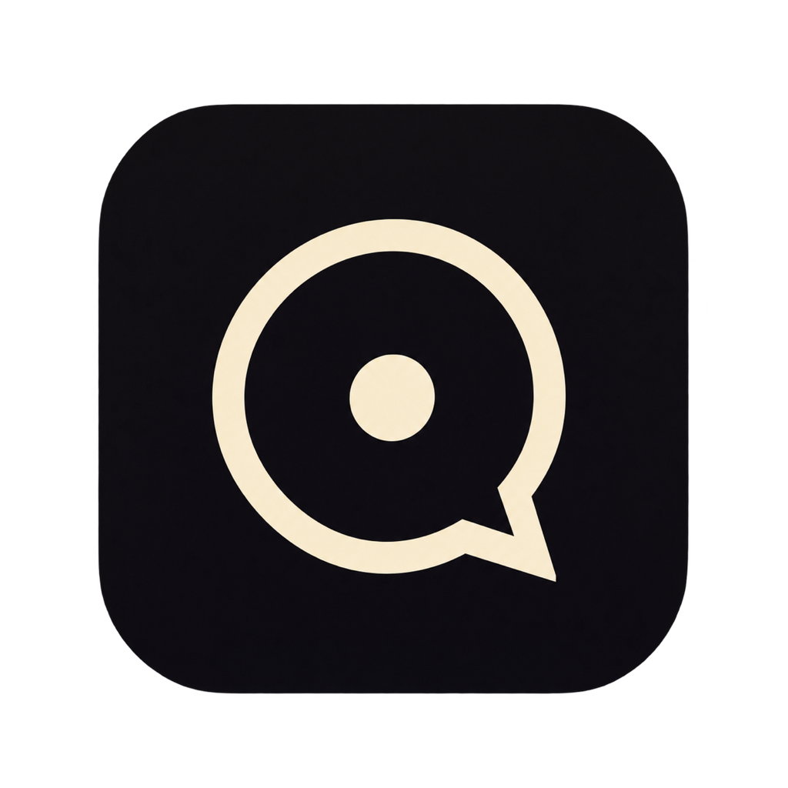
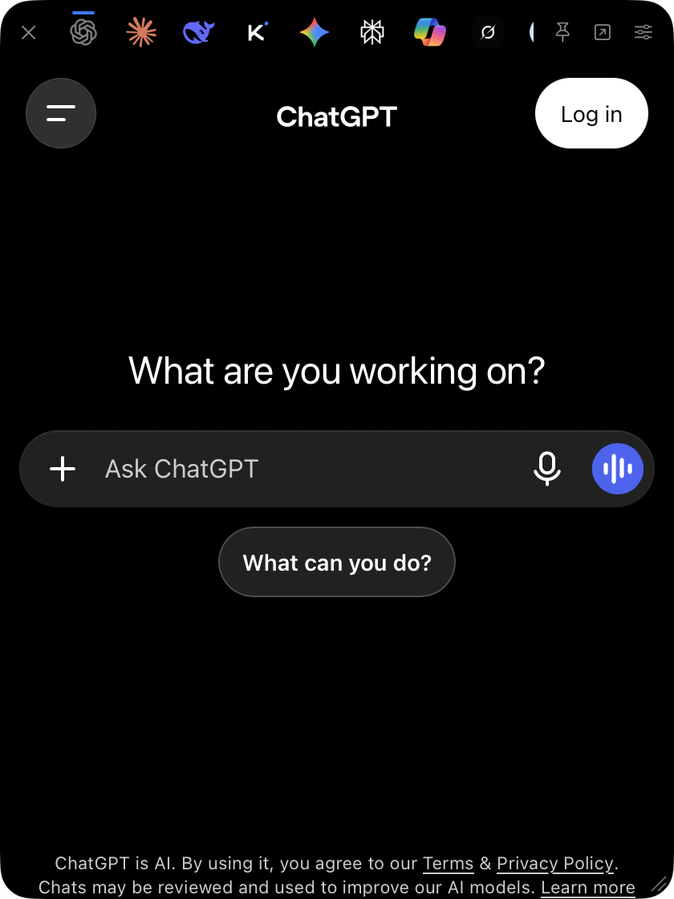
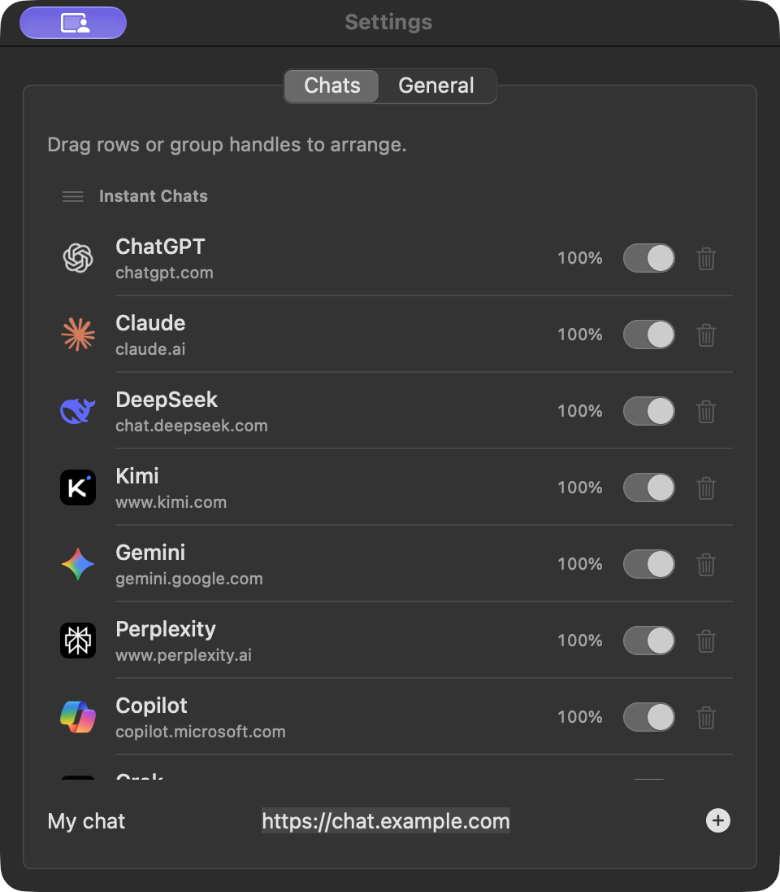
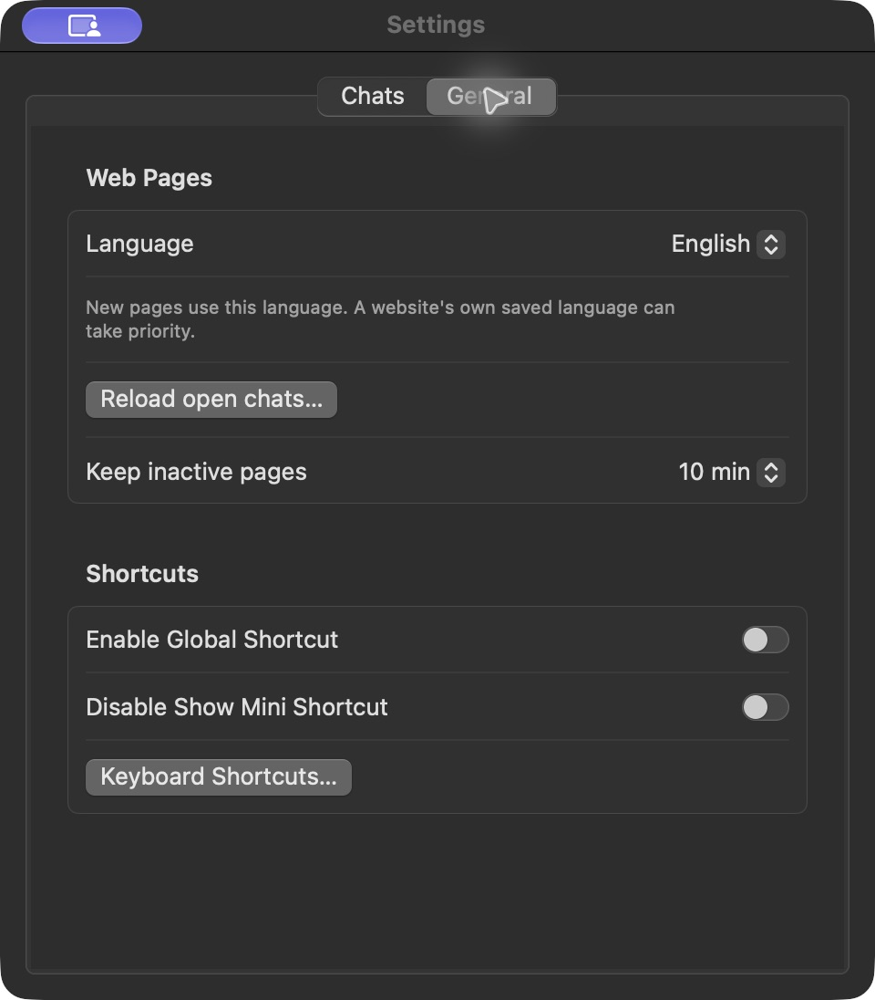

  
  <h1>FloatChat</h1>
  
<strong>常用的聊天网站，集中在一个 Mac 悬浮窗口里。</strong>

  
<a href="https://github.com/elvinzhao10/FloatChat/releases/latest"><strong>下载 Mac 版</strong></a> · <a href="README.md">English</a> · <a href="CHANGELOG.md">更新日志</a>

  
macOS 14 或更高版本 · 支持 Apple 芯片和 Intel Mac

  
FloatChat 把你常用的聊天网站放进一个小巧的 macOS 原生悬浮窗口。它使用 Swift、AppKit 和 macOS 自带的 WebKit，无需打包独立的浏览器运行环境。闲置页面会按设置释放。

  
直接在各个网站上登录。WebKit 在本机保存 FloatChat 的登录状态，与默认浏览器分开。FloatChat 无需单独注册账号或提供 API 密钥。你可以在使用其他 Mac 应用时保留悬浮窗口，也可随时在默认浏览器中打开当前页面。

  

  
        

  
内置 9 个平台，也可添加你常用的聊天网站。

## 安装与启动

1. 下载 **DMG**，打开后将 **FloatChat** 拖入**应用程序**文件夹。ZIP 版包含同一个应用。
2. 从**应用程序**打开 FloatChat。之后可点击菜单栏图标重新打开窗口，或在**设置 → 通用**启用全局快捷键 **⌥Space**。
3. 点击网站图标，直接使用已有账户登录。FloatChat 无需 API 密钥。

如果 macOS 阻止首次启动

首次启动使用临时签名的版本（如 0.3.4）时，macOS 可能要求手动批准。尝试打开应用后，确认安装包来自项目的官方发布页，然后选择**系统设置 → 隐私与安全性 → 仍要打开**。[Apple 的安全打开应用指南](https://support.apple.com/zh-cn/102445)

## 使用悬浮窗口

| 操作 | 方法 |
| --- | --- |
| 切换聊天 | 点击网站图标或按 **⌘1–9**。横向滚动图标栏可查看更多标签。 |
| 固定会话 | 点击图钉保存会话链接。即时聊天和固定会话在同一栏内，以细线分隔。将指针停在固定标签上可看会话主题。取消固定会关闭该标签。 |
| 调整网页大小 | 按 **⌘+** 或 **⌘−** 缩放，按 **⌘0** 还原。也可以点击 **设置 → 聊天**中任一条目旁的百分比，使用滑块独立调整缩放。 |
| 移动或调整大小 | 拖动窗口顶部移动，拖动角落调整大小，双击顶部放大或还原。 |
| 在浏览器中继续 | 点击箭头，在默认浏览器中打开当前页面。网站要求在浏览器登录或上传时，也可以用这个入口。 |
| 上传或下载文件 | 网站支持时，可使用上传按钮、粘贴或拖入文件。下载完成后，可点击**在访达中显示**查看文件。 |

## 添加你常用的聊天网站

1. 点击窗口右上角的滑杆图标，打开 **设置 → 聊天**。
2. 在底部输入网站名称和 HTTPS 地址，例如 `https://chat.example.com`，然后点击 **＋**。
3. 点击悬浮窗口中新增的图标，直接在网站上登录。

设置可以与悬浮窗口同时打开。在**聊天**中可以拖动排序、隐藏网站、点击铅笔修改内置或自定义网站的名称和地址，或为固定会话重命名。点击网站图标即可选取本地图片、恢复网站图标或刷新图标。右键点击标签可查看当前主机名或调整网页缩放。打开**通用 → 悬浮窗口**可选择打开位置、点击外部时隐藏，或用滑块调整背景透明度。文字与控件保持清晰。macOS 26 及以上使用液态玻璃效果。

## 页面保留与登录

FloatChat 会保留闲置聊天的实时页面。在**设置 → 通用 → 保留闲置的聊天**中，可以分别设置即时聊天和固定会话的保留时长。切换或隐藏窗口时开始计时。到期后，即时聊天会从起始页面重新开始，固定会话则打开已保存的链接。登录状态会保留。本次运行期间，FloatChat 可以恢复 ChatGPT 或 Claude 固定会话中未发送的纯文本草稿。页面释放后，附件和格式可能丢失。

在**设置 → 通用 → 显示回复指示灯**中启用后，后台生成回复的标签会显示小圆环。窗口隐藏时，点按可拖动的指示灯可重新打开最近一个正在生成的聊天。检测取决于网站是否提供可识别的停止按钮。将光标悬停在设置中的 **?** 上可查看说明。

FloatChat 与默认浏览器分别管理登录状态。隐藏或移除网站会保留它的本地登录。自定义网站图标通过独立的 HTTPS 会话直接向该网站获取，不携带聊天页面的 Cookie。

清除网站数据或卸载

卸载前，选择**设置 → 通用 → 隐私 → 清除所有网站登录…**并等待完成。此操作会清除 FloatChat 的本地网站数据。如果已经卸载，可从官方发布页重新安装，完成清除后退出并再次卸载。

如需手动清理，先退出 FloatChat。在 Finder 中按 **⇧⌘G**，分别检查 `~/Library/WebKit`、`~/Library/HTTPStorages` 和 `~/Library/Caches`。如果存在名为 `dev.quickchat.omni` 的文件夹，仅将该文件夹移入废纸篓。存储位置可能因 macOS 版本而异。需要完整清除登录时，建议使用应用内功能。

## 项目

[发布记录](https://github.com/elvinzhao10/FloatChat/releases) · [更新日志](CHANGELOG.md) · [安全说明](SECURITY.md) · [发布检查](docs/RELEASE-AUDIT.md) · [MIT 许可证](LICENSE)

从源代码构建

安装 Apple 命令行工具后运行 `make app`。应用会生成在 `build/FloatChat.app`。测试、自动更新与签名发布见[发布指南](docs/releases.md)。

基于 [shuaibird/Quick-Chat](https://github.com/shuaibird/Quick-Chat) 开发。各网站的名称与图标归其权利人所有。
